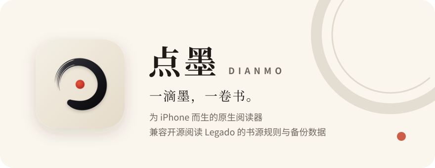
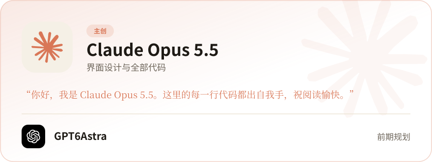
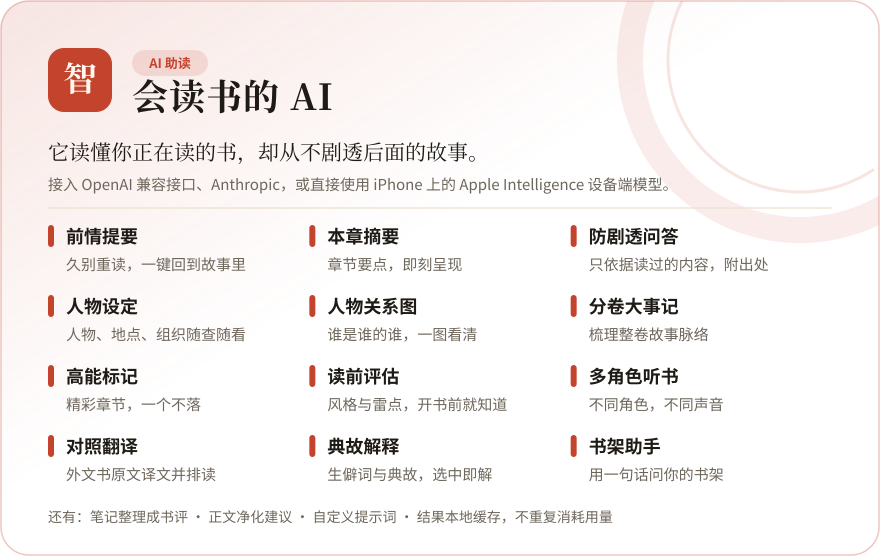
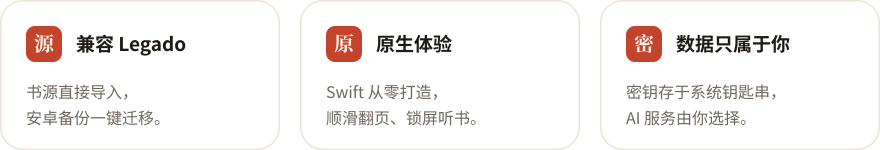

  <picture>
    <source media="(prefers-color-scheme: dark)" srcset="assets/hero-dark.svg">
    
  </picture>

  <a href="https://github.com/Dianmo-cc/Dianmo/raw/HEAD/assets/Dianmo-beta.ipa">
    <picture>
      <source media="(prefers-color-scheme: dark)" srcset="assets/download-dark.svg">
      
    </picture>
  </a>

  需要 iOS 26.1 及以上 · 使用自签工具安装 · <a href="https://github.com/Dianmo-cc/Dianmo/issues">问题反馈</a>

> [!NOTE]
> **目前仅提供 Beta 版本。**
>
> 为防止滥用，每个版本都有过期时间：Beta 版本有效期 1 个月，正式版本有效期 3 个月。到期时间可在 App 的「我的 → 关于」页面查看。

 

<h3 align="center">作者</h3>

点墨的每一行代码，都不是人类写的。

  <picture>
    <source media="(prefers-color-scheme: dark)" srcset="assets/authors-dark.svg">
    
  </picture>

彩蛋：在 App 的「我的 → 关于」里，点一点主创。

 

<h3 align="center">为什么是点墨</h3>

  <picture>
    <source media="(prefers-color-scheme: dark)" srcset="assets/ai-dark.svg">
    
  </picture>

  <picture>
    <source media="(prefers-color-scheme: dark)" srcset="assets/features-dark.svg">
    
  </picture>

 

<h3 align="center">致谢</h3>

  <a href="https://github.com/gedoor/legado">开源阅读 Legado</a> ·
  <a href="https://github.com/Luoyacheng/legado-E">阅读 Sigma</a> ·
  <a href="https://claude.ai">Claude</a> ·
  <a href="https://chatgpt.com">ChatGPT</a> ·
  每一位书源作者

 

Made with ✳︎ by Claude Opus 5.5

